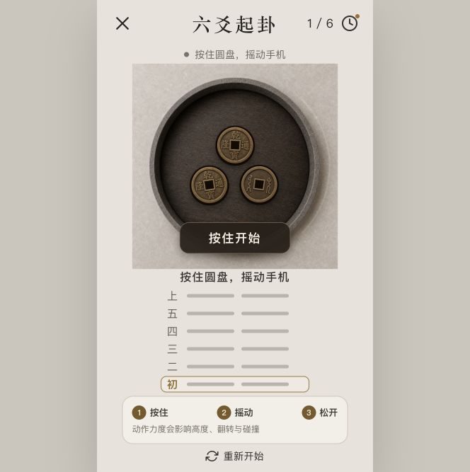
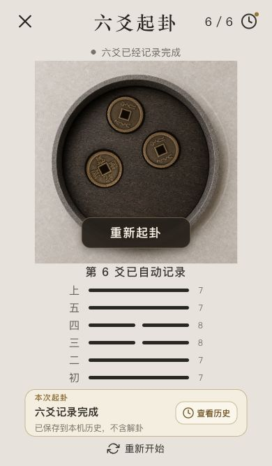
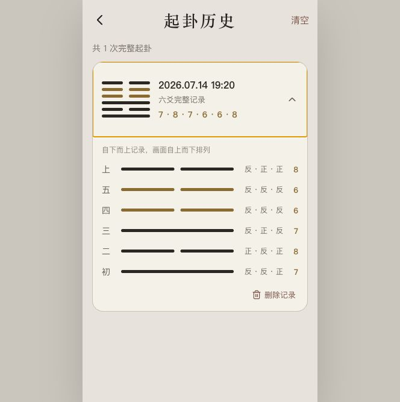
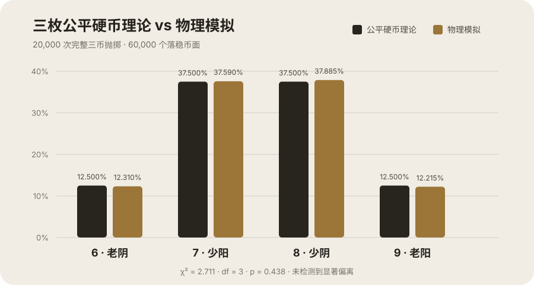

# 六爻抛币

用手机动作传感器驱动三枚实体感铜钱的物理抛掷模拟。每轮只记录三枚硬币的正反与一爻，自下而上完成六轮；不解卦、不判断吉凶、不上传数据。

[](https://github.com/wxc1111/liuyao-cast/actions/workflows/ci.yml)
[](LICENSE)
[](https://github.com/wxc1111/liuyao-cast/releases/tag/v0.1.0-beta.0)

> 当前版本：`v0.1.0 Beta`。Android 真机核心流程已经验证；iPhone 和 iPad 仍需真机验证。

**[下载 Android APK](https://github.com/wxc1111/liuyao-cast/releases/tag/v0.1.0-beta.0)**

## 界面预览

<p align="center">
  
  
  
</p>

## 为什么它不是普通随机数动画

- `DeviceMotion` 持续读取去重力加速度、重力方向与旋转速度。
- 手机倾斜转换为盘面持续受力；摇动能量影响抛起高度、初速度、翻转和自转。
- 每帧计算重力、地面回弹、静摩擦、盘壁碰撞和三枚铜钱之间的碰撞。
- 正反来自铜钱落稳后的最终翻转角度，不会在动画结束后重新随机。
- 只有三枚铜钱都可感知地静止后才记录当前爻。

## 与三枚公平硬币的概率对比

对完整物理引擎执行了 **20,000 次三币抛掷**，共统计 60,000 个落稳币面。每次测试都会改变摇动时长、加速度、倾斜、旋转速度和释放参数，并等待碰撞与落稳完成；没有直接随机生成最终正反。



| 结果 | 三枚公平硬币理论值 | 物理模拟值 | 偏差 | 样本数 |
| --- | ---: | ---: | ---: | ---: |
| 6（老阴） | 12.500% | 12.310% | -0.190 个百分点 | 2,462 |
| 7（少阳） | 37.500% | 37.590% | +0.090 个百分点 | 7,518 |
| 8（少阴） | 37.500% | 37.885% | +0.385 个百分点 | 7,577 |
| 9（老阳） | 12.500% | 12.215% | -0.285 个百分点 | 2,443 |
| 单枚正面 | 50.000% | 50.002% | +0.002 个百分点 | 30,001 / 60,000 |

- 卡方拟合检验：`χ² = 2.711`，`df = 3`，`p = 0.438`，未检测到相对公平三硬币理论分布的显著偏离。
- 三枚硬币两两相关系数的最大绝对值为 `0.0089`。
- 20,000 次模拟全部落稳；平均落稳时间 `3.051 s`，最长 `3.600 s`。

这个结果说明当前物理参数在总体分布上与三枚独立公平硬币相容，但不等同于证明所有设备、所有动作输入下都绝对无偏。完整方法、限制与复现说明见 [概率基准报告](docs/probability-benchmark.md)。

```bash
npm run benchmark:probability
```

## 功能

- 每轮同时模拟三枚有厚度的铜钱，完成六轮后形成一次完整记录。
- 历史记录包含时间、六爻结果及每爻的三枚硬币正反。
- 当前进度和完整历史只保存在设备本地。
- 传感器不可用时提供明确标识的触控降级操作。
- 浏览器预览复用相同规则与视觉，方便检查界面和核心流程。

## 项目结构

```text
.
├── mobile/                     # Expo SDK 57 原生应用
│   └── src/core/
│       ├── physics.ts          # 三币物理模拟内核
│       └── casting.ts          # 三币结果与 6/7/8/9 的映射
├── scripts/
│   └── probability-benchmark.mjs
├── src/                        # Vite 浏览器预览
├── docs/                       # 截图与概率报告
└── tests/physics.test.ts       # 规则与物理稳定性测试
```

## 本地运行

环境要求：Node.js 22.13 或更高版本、npm，以及真机上的 Expo Go 或自行构建的客户端。

浏览器预览：

```bash
npm ci
npm run dev
```

手机真机：

```bash
cd mobile
npm ci
npx expo start
```

动作传感器与触觉反馈必须在真实手机上验证。桌面浏览器和模拟器只能验证规则、视觉与部分交互。

## 检查

```bash
npm run check
npm run benchmark:probability
npm --prefix mobile run export:android
npm --prefix mobile run export:ios
cd mobile && npx expo-doctor
```

GitHub Actions 会对每次提交和 Pull Request 自动执行上述核心检查。

## EAS 构建

仓库中的 `mobile/app.json` 关联官方项目的 EAS 标识。Fork 后如需使用自己的 Expo 账号构建，请替换 `owner`、`extra.eas.projectId`、Android package 和 iOS bundle identifier，然后运行：

```bash
cd mobile
npx eas-cli init
npx eas-cli build --platform android --profile preview
```

APK、AAB 和 IPA 不提交到 Git 历史；安装包通过 GitHub Releases 发布。

## 隐私与产品边界

- 不需要账号，没有后端服务或分析 SDK。
- 不上传动作传感器、起卦历史或其他用户数据。
- 不解释卦象，也不生成占卜或命运判断文案。

## 素材与第三方许可

铜钱、托盘与界面视觉素材为本项目 AI 辅助生成并经人工筛选的素材，随项目按 MIT License 发布。依赖、图标和字体保留各自许可证；详见 [素材说明](ASSETS.md) 与 [第三方声明](THIRD_PARTY_NOTICES.md)。

## 贡献

欢迎提交问题和改进。请先阅读 [CONTRIBUTING.md](CONTRIBUTING.md)。涉及物理参数或动作阈值的改动，应附带概率基准、自动化测试和至少一台真实设备的验证说明。

## 许可证

本项目使用 [MIT License](LICENSE)。
